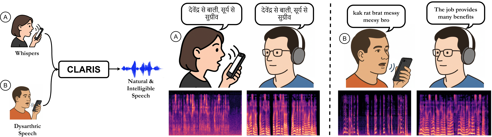

# CLARIS: Clear and Intelligible Speech from Whispered and Dysarthric Voices

[](https://doi.org/10.1145/3772318.3791734)
[](https://dl.acm.org/doi/pdf/10.1145/3772318.3791734)
[](https://claris-w2s.github.io/CLARIS/)
[](./android_beam_demo)
[](./LICENSE)
[](https://colab.research.google.com/github/Yash-Kumar-tech/CLARIS-Inference/blob/main/demo_inference.ipynb)

<p align="center">
  
</p>

This is the official inference code for the paper titled: "CLARIS: Clear and Intelligible Speech from Whispered and Dysarthric Voices", accepted to the ACM (Association for Computing Machinery) CHI conference on Human Factors in Computing Systems 2026.

The **demo_inference.ipynb** notebook enables straightforward inference, allowing users to seamlessly convert whispered or dysarthric audio into intelligible speech by simply executing the notebook cells.

Checkpoints available at <a href="https://drive.google.com/drive/folders/1EAWnMmtnqljDRuTfoD9CQORqNFqRKkYg?usp=sharing">GDrive</a>

## Key Features

- **Transformer-based S2U Architecture**: Auto-Regressive Transformer for CLARIS.
- **Beam Search Decoding**: Optimized `SequenceGenerator` for high-quality unit generation.
- **Integrated Vocoding**: Built-in support for Code HiFi-GAN to convert units directly to audio waveforms.
- **Flexible Configuration**: Dataclass-based parameter management in `params.py`.
- **Ensemble Support**: Components for model ensembling to improve inference robustness.
- **On-Device Mobile Inference**: Standalone Android application with real-time beam search tree visualization running locally on CPU via LiteRT and ONNX Runtime.

## Project Structure

```text
CLARIS_Inference/
├── android_beam_demo/              # Android on-device demo app with real-time beam search visualization
├── data/                           # Dataset handling and collation logic
├── models/                         # Core model architectures (SpeechToUnitTransformer)
├── modules/                        # Transformer building blocks (Attention, Layers, etc.)
├── vocoders/                       # Vocoder implementations (CodeHiFiGAN)
├── params.py                       # Configuration and hyperparameter definitions
├── sequence_generator.py           # Beam search decoding logic
├── infer_beam.py                   # Main inference entry point for generating units
├── generate_waveform_from_code.py  # Script for unit-to-waveform conversion
└── utils.py                        # Helper functions and Dictionary management
```

## Getting Started

### Installation

Clone the repository and install the dependencies:

```bash
pip install -r requirements.txt
```

### Optional Dependencies

For running optimized inference with OpenVINO or ONNX, install the additional packages:

- **OpenVINO**: `pip install openvino==2025.2.0`
- **ONNX Runtime**: `pip install onnxruntime-gpu==1.23.0`

### Model Checkpoints

Ensure you have the required model checkpoints in the root directory:
- `checkpoint.pt`: The S2U transformer model weights.
- `vocoder.pt`: The Code HiFi-GAN vocoder weights.

## Usage

### 1. Generate Units from Audio Features

Use `infer_beam.py` to perform inference on input features and generate discrete units.

```bash
python infer_beam.py
```
*Note: Ensure your input features are placed in the directory specified in `infer_beam.py` (default: `./whisper/`).*

### 2. Generate Waveforms from Units

Once you have generated the `.unit` file, use `generate_waveform_from_code.py` to synthesize audio.

```bash
python generate_waveform_from_code.py --inCodeFile predictions_whisper.unit --vocoder <path_to_vocoder_checkpoint> --resultsPath ./output_audio/
```

#### Arguments for `generate_waveform_from_code.py`:
- `--inCodeFile`: Path to the generated units file.
- `--vocoder`: Path to the HiFi-GAN vocoder checkpoint.
- `--resultsPath`: Directory to save the output `.wav` files.
- `--durPrediction`: Enable duration prediction (if supported by the model).
- `--cpu`: Force CPU inference (GPU inference not supported yet for Vocoder but CPU-only inference is fast enough).

## Configuration

The system is highly configurable via `params.py`. You can adjust:
- **Model Architecture**: Layers, embedding dimensions, attention heads, etc.
- **Generation Parameters**: Beam size, n-best hypotheses.
- **Vocoder Parameters**: Upsample rates, kernel sizes, and dilation.

## Optimized Inference

For production environments, models can be exported to ONNX and OpenVINO for significantly faster inference. The models are designed to be exportable without any changes to the core architecture.

### 1. ONNX Export
Use `export.py` to generate ONNX representations of the encoder and decoder.

```bash
python export.py
```
This produces:
- `encoder.onnx`: The speech encoder module.
- `decoder.onnx`: The unit decoder module (supporting dynamic-length autoregressive decoding).

The models are exported with **dynamic axes** for sequence lengths, allowing them to handle variable-duration speech inputs.

### 2. OpenVINO Conversion
Once the ONNX models are generated, convert them to OpenVINO IR format using `exportToOV.py`.

```bash
python exportToOV.py
```
This script saves the models in the OpenVINO format (`.xml` and `.bin`), which are optimized for execution on Intel CPUs.

## 📱 Android Demo Application

A standalone on-device Android application executing the complete CLARIS S2U inference pipeline locally on-device (`arm64-v8a`) is provided in [`android_beam_demo/`](./android_beam_demo).

### Highlights
- **On-Device Pipeline**:
  - **Feature Extraction**: 80-bin fbank + CMVN via `kaldi-native-fbank` (JNI)
  - **Encoder**: Quantized LiteRT int8 model (`encoder.litert`)
  - **Decoder**: Quantized LiteRT-LM batched beam search bridge (`decoder_lm_beam3.litertlm`, `liblitert_lm_shared.so`)
  - **Duration Predictor**: Quantized LiteRT model (`dur_predictor.litert`)
  - **Vocoder**: HiFi-GAN ONNX Runtime (`vocoder.onnx`, `vocoder.onnx.data`, `libonnxruntime.so`) $\rightarrow$ 16 kHz audio
- **Beam Search Visualization**: The UI dynamically renders the autoregressive beam hypothesis expansion and pruning across decoding steps.
- **Offline & Self-Contained**: Runs completely offline on CPU with bundled wTIMIT validation recordings.

### Download & Build
- **Prebuilt APK**: Download `claris-beam-demo.apk` directly from [GitHub Releases](https://github.com/Yash-Kumar-tech/CLARIS-Inference/releases/tag/v1.0.0).
- **Build from Source**:
  ```bash
  cd android_beam_demo
  ./gradlew :app:assembleDebug
  ```
  *(Requires Android SDK and NDK with CMake 3.22.1).*

For detailed architecture and layout, see [`android_beam_demo/README.md`](./android_beam_demo/README.md).

## Citation

If you find CLARIS helpful in your research, please cite our paper:

```bibtex
@inproceedings{10.1145/3772318.3791734,
author = {Shah, Neil and Sonkar, Yash and Subhash Karande, Shirish and Gandhi, Vineet},
title = {CLARIS: Clear and Intelligible Speech from Whispered and Dysarthric Voices},
year = {2026},
isbn = {9798400722783},
publisher = {Association for Computing Machinery},
address = {New York, NY, USA},
url = {https://doi.org/10.1145/3772318.3791734},
doi = {10.1145/3772318.3791734},
abstract = {Whispered and dysarthric speech hinder effective communication and undermine the reliability of voice-enabled systems. We present CLARIS, a compact speech-to-speech restoration system that turns such atypical input into clear, expressive speech. CLARIS requires no disorder-specific architectural tuning, generalizes across languages, and adapts quickly to new accents and speakers, enabling practical personalization. On whispered English, Hindi, and clinically challenging dysarthric speech, CLARIS delivers state-of-the-art intelligibility and naturalness, with listener studies confirming gains in quality, intelligibility, naturalness, and prosody. The system runs in real time, converting one second of input in about 30ms and enables inclusive, private, and personalized voice interaction. Audio samples are available at https://claris-w2s.github.io/CLARIS/},
booktitle = {Proceedings of the 2026 CHI Conference on Human Factors in Computing Systems},
articleno = {1410},
numpages = {18},
keywords = {speech interaction, whispered voice, dysarthric voice, voice conversion, silent speech, transfer learning, speech disorders},
location = {Barcelona, Spain},
series = {CHI '26}
}
```

## License

This project is licensed under the MIT No Attribution (MIT-0) License - see the [LICENSE](LICENSE) file for details.

## TODO

- [X] Release code for the CLARIS mobile application.
- [X] Provide dataset splits files for reproducibility.

---

## Acknowledgements

This project builds upon and takes inspiration from the following repositories:
- [fairseq](https://github.com/facebookresearch/fairseq): For the core Transformer and S2T architecture references.
- [speech-resynthesis](https://github.com/facebookresearch/speech-resynthesis): For unit-to-speech vocoding and data processing logic.

---
